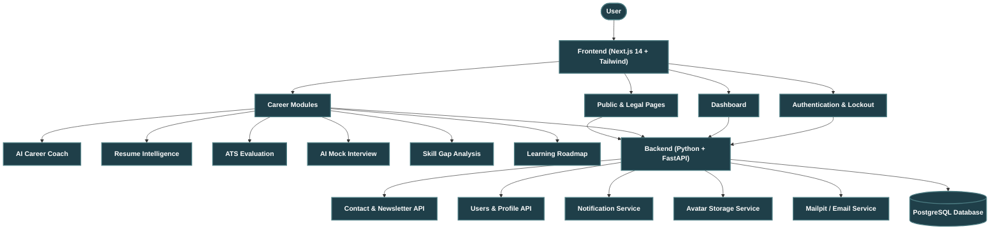

# 🚀 CareerPilot AI 

CareerPilot AI is an advanced, AI-driven career coaching platform built with Next.js, FastAPI, PostgreSQL, and a multi-agent AI Orchestrator architecture.

Developed by **Mudassar Hussain** (BS Artificial Intelligence, The Islamia University of Bahawalpur, Session 2024-2027) under the academic supervision of **Mr. Haseeb Ali**.

Currently operating at **Phase 3: Shared Features & Platform Security**.

---

## 🏗 System Architecture



---

## ✨ Phase 3 Features Implemented

### 1. Backend Enhancements
- **Brand Configuration (`app/core/brand.py`):** Single source of truth for owner details, supervisor, and contact information.
- **Extended User & Security Models:** Profile completeness, avatar upload, password change, account lockout (5 failed attempts = 15 min lock), user preferences, consent records, audit logs.
- **Contact & Rate Limiting (`POST /api/contact`):** 5 messages/hr rate limiting per IP, honeypot bot validation, auto-reply email dispatch.
- **Newsletter Service (`/api/newsletter`):** Double opt-in confirmation support and instant unsubscribe endpoint (`GET /unsubscribe`).
- **Notifications Engine (`/api/notifications`):** Unread count polling, mark read, mark all read, and clear all.

### 2. Frontend Public & Shared Features
- **Visitor Landing Page (`/`):** Hero section, 6 intelligence module cards, workflow overview, FAQ preview, CTA banner, and auth redirect.
- **Shared Footer:** Global site footer with newsletter input, product/company navigation links, and brand socials.
- **Contact Form Page (`/contact`):** Subject select dropdown, consent checkbox, aria-live accessibility, and rate limit error handling.
- **Profile & Settings (`/profile`, `/settings`):** Live completeness bar, avatar upload, headline/bio, preferences toggle, password update, JSON export, and account deletion modal.
- **Auth Security Gaps:** `/forgot-password`, `/reset-password`, 30-day token expiration support.
- **Information & Legal Pages:** About page (`/about`), FAQ (`/faq`), Privacy Policy (`/privacy`), Terms of Use (`/terms`).

---

## 🛠 Local Setup & Running Instructions

### Quick Start (Single Launcher)
Run `test.bat` at the root directory to apply database migrations and launch both backend and frontend servers:

```bash
.\test.bat
```

### Manual Service Launch

1. **Database Migration:**
   ```bash
   cd backend
   alembic upgrade head
   ```

2. **Backend API (FastAPI):**
   ```bash
   cd backend
   uvicorn app.main:app --reload --port 8000
   ```
   *API Swagger Docs available at [http://localhost:8000/docs](http://localhost:8000/docs)*

3. **Frontend (Next.js):**
   ```bash
   cd frontend
   npm install
   npm run dev
   ```
   *Frontend available at [http://localhost:3000](http://localhost:3000)*

4. **Mailpit Web UI (Local Email Testing):**
   *Mailpit interface available at [http://localhost:8025](http://localhost:8025)*

